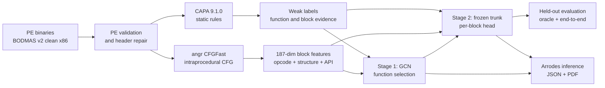

# CFG-GNN

<p align="center">
  
  
  
  
  
  
</p>

> Function-level and basic-block-level localisation of malicious behaviour in
> 32-bit Windows PE binaries using control-flow graphs (CFGs) and graph neural
> networks (GNNs).

**Status (2026-10-23):** research prototype. The active contract has three
independent targets: `anti_debug`, `keylogger`, and `injection`. Stage 1 and
Stage 2 are trained and evaluated once on a frozen cluster-stratified test
split. Single-binary inference is implemented and feature-parity tested. The GAT
comparison remains deferred, and manual Ghidra block-label validation is open.

The project is **not** a benign-versus-malicious detector, a malware-family
classifier, or a claim that CAPA rule matches are ground truth. A function with
no selected target is the background case (sometimes called class 0 in the
project notes), not a benign verdict.

---

## Contents

- [Results at a glance](#results-at-a-glance)
- [Overview](#overview)
- [Research problem and objectives](#research-problem-and-objectives)
- [Pipeline architecture](#pipeline-architecture)
- [Feature engineering](#feature-engineering)
- [Model architecture](#model-architecture)
- [Dataset and labeling methodology](#dataset-and-labeling-methodology)
- [Experimental design and evaluation](#experimental-design-and-evaluation)
- [Results](#results)
- [Verification](#verification)
- [Project structure](#project-structure)
- [Installation and setup](#installation-and-setup)
- [Usage and reproduction](#usage-and-reproduction)
- [Limitations and threats to validity](#limitations-and-threats-to-validity)
- [Security and data handling](#security-and-data-handling)
- [References and acknowledgments](#references-and-acknowledgments)

---

## Results at a glance

| Evaluation | Metric | Result |
|---|---|---:|
| Stage 1 function selection | macro F1 | **0.4890** |
| Stage 1 any-target selection | F1 | **0.4948** |
| Stage 2, oracle functions | macro block F1 / IoU | **0.4586 / 0.3373** |
| Stage 2, end-to-end | macro block F1 / IoU | **0.3723 / 0.2375** |

The background (not-selected) F1 is **0.9976**. That figure is dominated by the
malware-only corpus and class imbalance; it is not evidence of benign detection.
The full per-target tables and caveats are in [Results](#results).

The aggregate project report is [`results/final_report.pdf`](results/final_report.pdf).
The per-target technical reports are
[`results/train/stage1/report.md`](results/train/stage1/report.md) and
[`results/train/stage2/report.md`](results/train/stage2/report.md).

---

## Overview

Malware behaviour is sparse inside a binary: a small number of functions carry a
capability, and only a few basic blocks inside those functions contain the
relevant instructions or API references. CFG-GNN models that hierarchy directly.

The pipeline recovers an intraprocedural CFG with angr, represents every basic
block as a 187-dimensional feature vector, and applies a GCN over the CFG. A
function-level head selects functions for the three targets. A second head,
trained on the frozen function-level trunk, scores individual basic blocks
inside selected functions. The result is a function ranking plus concrete
virtual addresses for block-level evidence.

The model is deliberately lightweight: two message-passing layers, a small
pooling/MLP head, and CPU-only PyTorch. The scientific contribution being tested
is the hierarchical localisation setup and its evaluation under weak,
CAPA-derived labels — not a new state-of-the-art malware detector.

---

## Research problem and objectives

**Problem.** Given a malware-only corpus of 32-bit PE files, recover functions
and basic blocks statically, then answer two questions:

1. Which functions implement one or more of the target behaviours?
2. Inside a selected function, which basic blocks carry the behaviour?

**Targets.** The labels are CAPA namespace matches. They are observational weak
labels, not manual annotations.

| Target | CAPA namespace prefix | What the label approximately measures |
|---|---|---|
| `anti_debug` | `anti-analysis/anti-debugging` | Anti-debugging / anti-analysis rule evidence |
| `keylogger` | `collection/keylog` | Keyboard-state API presence and keylogging rule evidence |
| `injection` | `host-interaction/process/inject`, `load-code/pe/inject-` | Process/PE injection rule evidence, often RWX allocation |
| *(background)* | none of the above | Not selected; **not** a benign verdict |

**Objectives.**

- Build a reproducible function-level and block-level label pipeline from CAPA
  evidence and stored angr CFGs.
- Train a multi-label GCN baseline with three independent sigmoids.
- Localise blocks inside selected functions with a frozen-trunk block head.
- Evaluate with cluster-aware splits, validation-only threshold tuning, and a
  single held-out test pass.
- Expose a single-binary inference path with JSON and PDF reports.

**Non-goals.** Benign-versus-malicious classification, malware-family
attribution, dynamic analysis, x64/ELF/ARM support, and claims of manual
ground-truth block annotation are out of scope.

---

## Pipeline architecture



CAPA is used **offline for supervision only**. At inference time the model
receives the PE file, the extracted CFG, and the 187 block features. No CAPA
rule name, target string, or label value enters the model input, and CAPA is not
invoked by the inference command.

The split, label table, and feature corpus are frozen artifacts. The test split
is evaluated once after model selection; it is never used for early stopping or
threshold tuning.

---

## Feature engineering

Each basic block is represented by a 187-dimensional vector:

| Dimensions | Feature |
|---|---|
| 0–114 | 115 opcode-frequency dimensions: 114 named opcodes plus `other` |
| 115–119 | `log1p(block size)`, `log1p(instructions)`, `log1p(in-degree)`, `log1p(out-degree)`, `is-entry` |
| 120–183 | 64 hashed API-reference buckets |
| 184–186 | `log1p(resolved API calls)`, `log1p(distinct API buckets)`, `has API call` |

The opcode vocabulary includes system and anti-debug instructions such as
`rdtsc`, `rdpmc`, `icebp`, `int1`, `cpuid`, `pushfd`/`popfd`, `in`/`out`, and
`sysenter`/`syscall`, not just general integer operations.

API references are resolved from the PE import table through import thunks and
through import-reference instruction sites (`call/jmp dword ptr [IAT]`). The
second route matters for keylogger and injection calls that angr does not
resolve to a call target. API names are hashed into stable buckets; the model
never receives raw DLL/function strings or CAPA rule names.

Features are standardized with the mean and standard deviation computed on the
training split only. The feature layout is recorded in
[`results/corpus_v2_three_targets/feature_spec.json`](results/corpus_v2_three_targets/feature_spec.json).

---

## Model architecture

| Component | Implementation |
|---|---|
| Graph | One graph per binary; nodes are basic blocks; edges are intraprocedural CFG edges |
| Encoder | Two GCN message-passing layers, 64 hidden dimensions, residual skip, ReLU, dropout |
| Pooling | Mean and max pooling over each function's blocks, keyed by `node_func_id` |
| Function head | 128 → 64 → 3 MLP, three independent logits |
| Block head | Linear 64 → 3 on the shared, frozen Stage 1 trunk |
| Batching | Block-diagonal graph batching shared by training and inference |
| Framework | PyTorch 2.14 CPU; no PyTorch Geometric code in the current model |

**Stage 1** is trained with `BCEWithLogitsLoss` and a capped positive weight.
Per-target thresholds are selected on the validation split and stored in the
checkpoint. A function can match more than one target.

**Stage 2** keeps the Stage 1 encoder frozen and trains only the per-block head.
The block labels are seeded from CAPA evidence locations and import-resolved
API-call blocks inside positive functions. The validation-selected block
thresholds are `anti_debug` 0.94, `keylogger` 0.50, and `injection` 0.64.

A GAT encoder is a natural comparison, but it is **not implemented or
evaluated** in this repository. No GAT results are claimed.

---

## Dataset and labeling methodology

| Item | Value |
|---|---|
| Source | BODMAS v2 clean set, 32-bit x86 PE |
| Clean samples | 2,733 |
| Clean clusters | 303 |
| Extracted graphs | 2,729 (4 angr failures recorded) |
| Graph corpus | 2,749,125 functions; 17,957,769 blocks; 16,609,971 intraprocedural edges |
| Label table | 2,727 samples; 2,712,053 mapped functions |
| Label states | 3,044 positive; 377,257 weak negative; 2,331,752 unlabeled |
| Target positives | `anti_debug` 448; `keylogger` 1,255; `injection` 1,349 |

The four extraction failures are recorded rather than silently treated as
negatives. Zero-rule samples are excluded from the loss and metrics; unmapped
functions are `unlabeled`, not weak negatives.

### Label states

| State | Definition | Used in loss/metrics |
|---|---|---|
| `positive` | Mapped function with at least one active target rule match | Yes, as positive |
| `weak_negative` | Mapped function with no target match, in a sample where CAPA matched at least one rule of any kind | Yes, as negative |
| `unlabeled` | Unmapped function, or a sample with no CAPA rule match at all | No |
| `background` | No target selected at prediction time | Reported as “not selected,” not “benign” |

### What the labels actually measure

Function-scope CAPA matches are localised through CAPA's reported evidence
locations, not by inheriting the whole CAPA function start. For example, an
anti-debug rule is attached to the angr function containing the reported
`rdtsc`/`icebp` instruction. This reduced the anti-debug count from 534 to 448
and removed inherited positives; it does not remove the underlying label
concentration.

| Target | Positive functions | Positive samples | Clusters | Families | Top-cluster share |
|---|---:|---:|---:|---:|---:|
| `anti_debug` | 448 | 373 | 21 | 10 | 61.2 % |
| `keylogger` | 1,255 | 242 | 41 | 12 | 75.7 % |
| `injection` | 1,349 | 804 | 108 | 12 | 32.9 % |

The concentration is a property of the CAPA label, not of the model. The
keylogger label is largely keyboard-state API presence, and the injection label
is dominated by RWX allocation. The audit is in
[`results/audit/label_composition.md`](results/audit/label_composition.md).

### Block labels

Stage 2 labels are block-level seeds inside positive functions:

1. CAPA evidence locations for the same namespaces, including basic-block
   matches and nested evidence from function-scope matches.
2. Blocks inside a positive function that contain an import-resolved API
   reference.

Every other block in a positive function is a negative block. Blocks in
weak-negative or unlabeled functions are excluded. These are weak localisation
labels, not hand-verified malicious blocks.

### Split and leakage control

The active split is `data/versions/v2/splits/three_target.json`, protocol
`three-target-cluster-stratified-v3`. It is grouped by `cluster_key`
(`imphash:<hash>` or `sha:<content-sha256>`) so near-duplicate samples do not
cross train/validation/test.

| Split | Samples | `anti_debug` | `keylogger` | `injection` |
|---|---:|---:|---:|---:|
| Train | 1,913 | 394 | 950 | 944 |
| Validation | 410 | 27 | 152 | 203 |
| Test | 410 | 27 | 153 | 202 |

The Stage 1 corpus contains 1,909 / 410 / 409 usable graphs: four clean samples
in train have no extracted graph, and one test graph has zero recovered
functions. The frozen v2 `main.json` is retained as history but is **not used**
for these targets.

---

## Experimental design and evaluation

- **Model selection:** validation split only; macro F1 with per-target
  thresholds. The test split is evaluated once with those frozen thresholds.
- **Stage 1 metrics:** per-target precision, recall, F1, and average precision;
  any-target selection precision/recall/F1; background (not-selected)
  precision/recall/F1.
- **Stage 2 metrics:** block-level precision, recall, F1, IoU, and average
  precision. “Oracle functions” uses all true positive functions;
  “end-to-end” uses only functions selected by Stage 1.
- **Eligibility:** metrics are computed only on mapped functions in samples with
  at least one CAPA rule. Unlabeled functions and zero-rule samples are excluded,
  never treated as negatives.
- **Generalisation claim:** the split is cluster-aware, but it is not a
  family-held-out experiment. The three-target models do not claim family-level
  generalisation; the small test supports are reported with every result. A LOFO
  split exists in the frozen data but is not used for these three-target
  results.

The test supports are 27 anti-debug, 153 keylogger, and 202 injection functions.
Stage 2 test supports are 136, 1,344, and 2,094 blocks respectively.

---

## Results

### Stage 1 — function selection

Held-out test, evaluated once with validation-selected thresholds:

| Target | Test support | Threshold | Precision | Recall | F1 | AP |
|---|---:|---:|---:|---:|---:|---:|
| `anti_debug` | 27 | 0.95 | 0.7895 | 0.5556 | **0.6522** | 0.4836 |
| `keylogger` | 153 | 0.94 | 0.3292 | 0.3464 | **0.3376** | 0.2477 |
| `injection` | 202 | 0.95 | 0.3761 | 0.6535 | **0.4774** | 0.3327 |

Macro F1 is **0.4890**. Any-target selection F1 is **0.4948**. Background
(not-selected) F1 is **0.9976**. The background figure reflects the
malware-only, highly imbalanced setting; it is not a benign-detection result.

### Stage 2 — block localisation, oracle functions

| Target | Test blocks | Precision | Recall | F1 | IoU | AP |
|---|---:|---:|---:|---:|---:|---:|
| `anti_debug` | 136 | 1.0000 | 0.0588 | **0.1111** | 0.0588 | 0.3364 |
| `keylogger` | 1,344 | 0.4312 | 0.5900 | **0.4983** | 0.3318 | 0.4233 |
| `injection` | 2,094 | 0.6462 | 0.9413 | **0.7663** | 0.6212 | 0.6175 |

Macro oracle block F1 is **0.4586**; macro IoU is **0.3373**.

### Stage 2 — end-to-end from Stage 1 selections

| Target | Precision | Recall | F1 | IoU |
|---|---:|---:|---:|---:|
| `anti_debug` | 0.6667 | 0.1081 | **0.1860** | 0.1026 |
| `keylogger` | 0.2980 | 0.6598 | **0.4106** | 0.2583 |
| `injection` | 0.3585 | 0.9470 | **0.5202** | 0.3515 |

Macro end-to-end block F1 is **0.3723**; macro IoU is **0.2375**.

### Interpretation

- **Anti-debug** has the highest function precision (0.7895) but low recall
  (0.5556) on only 27 test positives. Its block threshold (0.94) is very
  conservative: oracle block recall is 0.0588, while block AP is 0.336, so the
  ranking is more informative than the thresholded result.
- **Keylogger** is the weakest target (F1 0.3376). The label is dominated by
  keyboard-state API presence and 75.7 % of positives come from one cluster.
- **Injection** has the strongest block localisation (oracle F1 0.7663), but the
  label is largely RWX allocation and the end-to-end F1 drops to 0.5202 because
  Stage 1 false positives add block false positives.
- **Macro scores are not family-wide generalisation claims.** The supports are
  small, the labels are weak, and the block IoU is low outside injection.
- The Stage 2 numbers measure recovery of CAPA/API seeds, not every malicious
  block in a binary.

Full tables, thresholds, and caveats are in the
[Stage 1 report](results/train/stage1/report.md) and
[Stage 2 report](results/train/stage2/report.md).

---

## Verification

| Check | Result |
|---|---|
| Unit and integration suite | **84 passed** (`./venv/bin/python -m pytest tests/ -q`) |
| Feature/model parity | Exact on the held-out parity sample; maximum feature and probability difference **0.0** |
| Three-sample held-out smoke check | Selected-function sets match the corpus batch exactly for all three targets |
| Static Capstone decode spot-check | 6/6 sampled injection blocks decode completely and end in IAT calls |
| Manual Ghidra block-label validation | **Open** — 40 functions selected, 0 verdicts recorded |

The Capstone spot-check is a decode sanity check, not manual label validation.
The repository has no CI workflow, so the test badge reflects the local suite,
not a hosted CI run. The held-out smoke record is
[`results/infer/inference_validation.json`](results/infer/inference_validation.json);
the decode check is
[`results/infer/block_spotcheck.json`](results/infer/block_spotcheck.json).

---

## Project structure

```text
.
├── bin/Arrodes                      # installed single-sample command
├── configs/                         # Phase 0, pilot, and three-target configs
├── data/
│   ├── labels/                      # tracked metadata; label tables are ignored
│   └── versions/v2/                 # frozen manifest, checksums, three-target split
├── docs/
│   ├── inference.md                 # CLI, output schema, failure modes
│   ├── labeling_contract.md         # label definitions and caveats
│   ├── label_pipeline.md            # full label/training runbook
│   ├── data/                        # BODMAS repair and x64 scope notes
│   └── archive/                     # superseded historical plans
├── results/
│   ├── audit/                       # label composition and concentration
│   ├── train/stage1/                # Stage 1 metrics and report
│   ├── train/stage2/                # Stage 2 metrics and report
│   ├── infer/                       # inference parity and spot-check evidence
│   ├── collect/                     # external collection probe (not current training data)
│   └── final_report.pdf             # aggregate project report
├── scripts/                         # installer, final-report generator, block spot-check
├── src/
│   ├── collect/                     # MalwareBazaar / theZoo collectors
│   ├── data/                        # manifest, repair, versioning, block labels
│   ├── extract/                     # angr CFG recovery and .npz store
│   ├── features/                    # 187-dimensional block features
│   ├── label/                       # CAPA parsing, mapping, merge, contract
│   ├── models/                      # GCN, block head, batching, standardizer
│   ├── train/                       # Stage 1 and Stage 2 trainers
│   ├── eval/                        # held-out and end-to-end evaluation
│   └── infer/                       # single-binary pipeline, JSON, PDF
├── tests/                           # unit, corpus-invariant, and inference tests
└── workspace/                       # per-sample outputs (ignored except .gitkeep)
```

A short index of the result directories is in
[`results/README.md`](results/README.md). Raw malware, CAPA JSON, serialized
graphs, label tables, and model checkpoints are deliberately git-ignored.

---

## Installation and setup

**Tested environment:** Python 3.14.7, PyTorch 2.14.0+cpu, angr 10.0.0, CPU-only.
`requirements.txt` lists the direct dependencies; `requirements.lock.txt` records
the frozen environment used for the reported results.

```bash
git clone https://github.com/skandarhadrich-cell/CFG-Function-Localization-via-Graph-Neural-Networks.git
cd CFG-Function-Localization-via-Graph-Neural-Networks

python3.14 -m venv venv
./venv/bin/pip install --upgrade pip
./venv/bin/pip install -r requirements.txt
```

**Data and external tools.**

- BODMAS v2 and raw malware are **not** shipped with the repository. See
  [`data/versions/v2/README.md`](data/versions/v2/README.md) and
  [`docs/data/bodmas_disarm.md`](docs/data/bodmas_disarm.md).
- CAPA 9.1.0 is required only to regenerate labels. It is not used at inference.
- angr performs static CFG recovery; the pipeline does not execute samples.
- Ghidra is optional and is used only for manual block-label validation.

**Checkpoints.** Inference requires
`results/train/stage1/best.pt` and `results/train/stage2/best.pt`. They are
git-ignored. Reproduce them with the training commands below or supply the
frozen checkpoints from the original experiment environment.

---

## Usage and reproduction

### Run the test suite

```bash
./venv/bin/python -m pytest tests/ -q
```

The corpus-dependent tests skip automatically when the local data or checkpoints
are absent. The reported run had the full local corpus available and passed all
84 tests.

### Single-binary inference

Install the `Arrodes` command once:

```bash
./scripts/install_arrodes.sh
```

Score one x86 PE:

```bash
Arrodes "path/to/sample.exe"
```

The wrapper is equivalent to `python -m src.infer.run "path"` and defaults the
workspace to this repository's `workspace/` directory, so it works from any
current directory. Every run writes both files under a folder named after the
input SHA-256:

```text
workspace/<sha256>/report.json
workspace/<sha256>/report.pdf
```

The PDF opens automatically. The JSON is the machine-readable source of truth;
the PDF is a human-readable rendering of the same result. The JSON schema,
per-target fields, block entries, and failure modes are documented in
[`docs/inference.md`](docs/inference.md).

Useful options:

```bash
# Reuse an already-extracted graph (still reads the PE for import resolution).
Arrodes "sample.exe" --graph data/graphs_v2/cfg/<sample_id>.npz

# Function scores only; no block localisation.
Arrodes "sample.exe" --no-stage2

# Change the output root.
Arrodes "sample.exe" --workspace /tmp/opencode/workspace
```

Non-x86 inputs and failed extractions exit with code 2 and an explicit error;
they are never mapped to a negative verdict.

### Training and evaluation on an existing corpus

The full rebuild is expensive and requires local malware, CAPA, and BODMAS. The
commands below assume the frozen corpus and split already exist.

```bash
# Stage 1: train without touching test.
./venv/bin/python -m src.train.stage1 \
  --corpus-dir results/corpus_v2_three_targets \
  --out-dir results/train/stage1 \
  --splits data/versions/v2/splits/three_target.json \
  --epochs 20 --patience 5 --batch-graphs 8 \
  --dropout 0.5 --weight-decay 0.005 \
  --edge-dropout 0.20 --feature-dropout 0.10 \
  --pos-weight-cap 300 --no-test

# Stage 1: evaluate the frozen test once.
./venv/bin/python -m src.eval.stage1_test \
  --checkpoint results/train/stage1/best.pt \
  --corpus-dir results/corpus_v2_three_targets \
  --splits data/versions/v2/splits/three_target.json \
  --split test --out-dir results/train/stage1

# Stage 2: build block labels and train the frozen-trunk block head.
./venv/bin/python -m src.data.build_block_labels \
  --labels data/labels/stage1_full_three_targets.parquet \
  --corpus-dir results/corpus_v2_three_targets

./venv/bin/python -m src.train.stage2 \
  --corpus-dir results/corpus_v2_three_targets \
  --stage1-checkpoint results/train/stage1/best.pt \
  --out-dir results/train/stage2 \
  --splits data/versions/v2/splits/three_target.json \
  --epochs 15 --patience 4 --batch-graphs 8 \
  --dropout 0.5 --lr 1e-3 --weight-decay 1e-4 \
  --edge-dropout 0.10 --feature-dropout 0.05 \
  --pos-weight-cap 50 --no-test

# Stage 2: oracle and end-to-end test evaluation.
./venv/bin/python -m src.eval.stage2_test \
  --checkpoint results/train/stage2/best.pt \
  --split test --out-dir results/train/stage2

./venv/bin/python -m src.eval.stage2_end_to_end \
  --stage1-checkpoint results/train/stage1/best.pt \
  --stage2-checkpoint results/train/stage2/best.pt \
  --split test --out-dir results/train/stage2
```

The complete data and label rebuild — manifest, CAPA, mapping, split, corpus,
and block labels — is documented in
[`docs/label_pipeline.md`](docs/label_pipeline.md). Do not run it as a routine
setup step.

---

## Limitations and threats to validity

- **Weak labels.** CAPA rule matches are not ground truth. The target names are
  shorthand for namespace matches, not proof of intent or capability.
- **Malware only.** There is no benign corpus. Background means “no target rule
  matched,” not “safe.” A benign-versus-malicious claim is out of scope.
- **Label concentration.** 75.7 % of keylogger positives and 61.2 % of
  anti-debug positives come from one cluster each. Keylogger is largely
  keyboard-state API presence. Held-out scores for these targets should be read
  per cluster, not as broad capability detection.
- **.NET blind spot.** The keylogger label is structurally blind to .NET
  P/Invoke keylogging because CAPA does not turn those calls into the native
  imports the relevant rules require. AgentTesla is the clearest example in the
  corpus.
- **Small test supports.** The test split contains 27 anti-debug, 153 keylogger,
  and 202 injection positive functions. Anti-debug block thresholds are unstable
  because validation has only 27 anti-debug functions.
- **x86 PE only.** ELF, ARM, and x64 are not in the corpus. The 855 x64 BODMAS
  rows are packed and fail the frozen v2 filter; see
  [`docs/data/x64_scope.md`](docs/data/x64_scope.md).
- **Static CFG recovery.** Packed binaries, indirect jumps, and missed code
  reduce recall. angr failures are recorded, not silently dropped.
- **Stage 2 labels.** CAPA evidence and import-resolved API-call blocks are weak
  localisation seeds. The metrics measure recovery of those seeds, not every
  malicious block. Manual Ghidra validation is still open.
- **No family attribution.** The project does not output malware-family labels,
  and the scores are not a family-attribution model.
- **No GAT result.** The GAT encoder is planned but not implemented or
  evaluated. The current claims apply to the GCN baseline only.
- **External collection probe.** The MalwareBazaar/theZoo probe in
  `results/collect/` is provenance for a possible future extension; it is not
  part of the current v2 training corpus.

---

## Security and data handling

- The repository **does not ship malware**. Raw samples, per-sample CAPA JSON,
  serialized CFGs, graph corpora, label tables, and checkpoints are git-ignored.
- Analysis is static. The pipeline does not execute samples.
- `workspace/` contains per-sample outputs and is ignored except for
  `workspace/.gitkeep`. Reports contain hashes, addresses, scores, and warnings;
  they do not embed sample bytes.
- The MalwareBazaar collector reads `MB_API_KEY` from a local `.env` file. The
  `.env` file is ignored and is not part of the repository; copy
  [`.env.example`](.env.example) and set the key locally if you use that
  collector.
- Do not commit samples, CAPA outputs, checkpoints, or reports that embed
  sensitive local paths or sample bytes.
- This is a research tool. Do not use it as an autonomous malware verdict or as
  a substitute for manual reverse engineering.

---

## References and acknowledgments

- **BODMAS** — Blue Hexagon / Whyisyoung: <https://github.com/whyisyoung/BODMAS>
- **CAPA** — Mandiant FLARE: <https://github.com/mandiant/capa>
- **angr** — Shoshitaishvili et al., “SoK: (State of) The Art of War: Offensive
  Techniques in Binary Analysis,” IEEE S&P 2016: <https://angr.io>
- **GCN** — Kipf and Welling, “Semi-Supervised Classification with Graph
  Convolutional Networks,” ICLR 2017: <https://arxiv.org/abs/1609.02907>
- **GAT** — Veličković et al., “Graph Attention Networks,” ICLR 2018:
  <https://arxiv.org/abs/1710.10903>
- **PyTorch** — Paszke et al., NeurIPS 2019: <https://pytorch.org>
- **Ghidra** — NSA: <https://ghidra-sre.org>

Thanks to the BODMAS, CAPA, angr, PyTorch, and Ghidra maintainers. The CAPA rules
used for the reported labels are pinned to commit
`805f9eaccfb6a4e1ddffc809d71d1e2b5ccc15e5` (CAPA 9.1.0).

**License:** no open-source license is declared in this repository. Add one
before redistributing or reusing the code.
